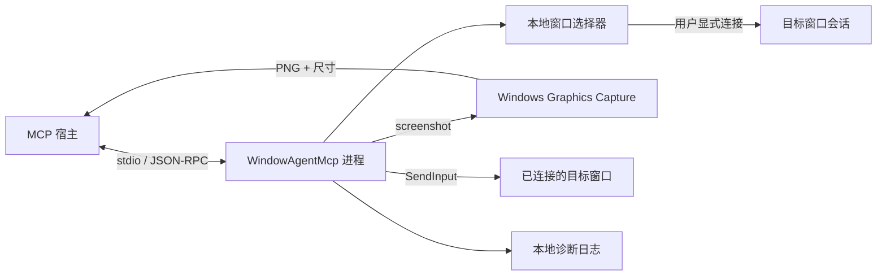
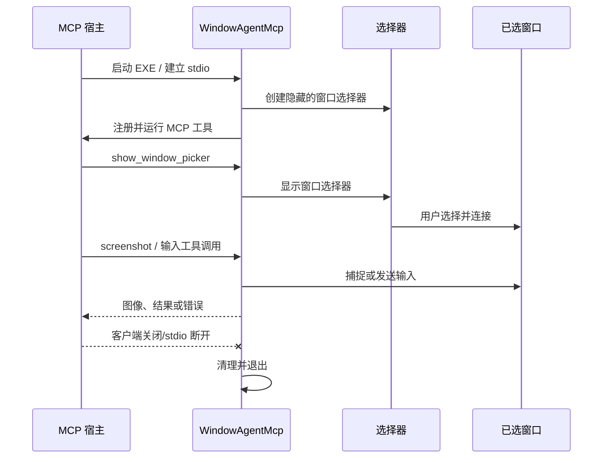

# 架构与诊断说明

## 组件

当前程序是一个 Windows x64 单进程应用。每次 MCP stdio 客户端启动服务 EXE 时，进程创建隐藏的 WPF 窗口选择器并启动 MCP 主机。工具发现不显示 GUI；`show_window_picker` 或无绑定目标的实际工具调用才显示选择器。



### 主要职责

- `App`：建立 WPF 消息循环，显示选择器并启动/停止 MCP 主机。
- `MainWindow`：列出可见顶层窗口；由用户连接或断开目标。
- `TargetWindowManager` 与 `WindowSession`：保存单个目标身份、捕捉会话和输入状态。
- `WindowCaptureService`：通过 Windows Graphics Capture 获取目标客户区图像并编码为 PNG。
- `InputController`：校验目标与坐标，通过 `SendInput` 执行鼠标和键盘输入。
- `WindowAutomationTools`：将截图和输入能力注册为 MCP 工具。
- `McpServerHost`：使用 stdio 承载 MCP。标准输出仅用于协议；日志输出到标准错误或本地诊断文件。

## 请求和目标绑定

MCP 工具只访问当前绑定的目标，不接收 HWND，也不提供自动选择目标的工具。`show_window_picker` 只显示供人类操作的选择器。每个输入请求会重新检查目标身份和客户区坐标；输入前尝试激活目标并检查前台窗口。目标失效或解除连接后，服务清除捕捉会话并尝试释放它所持有的键和鼠标按钮。

`screenshot` 返回 PNG 与客户区尺寸。Agent 应以图像左上角为原点解释像素坐标，并在每次输入后再次截图确认结果。

## 生命周期



每个 MCP 服务进程各自持有一个目标会话，选择器按需显示。宿主只进行元数据发现时，进程从启动到销毁都不显示选择器。正常关闭时，应用会释放绑定和持有的输入状态；如果宿主直接终止进程，进程内清理代码和关闭日志可能来不及执行。

## 诊断日志

默认目录：

```text
%LOCALAPPDATA%\WindowAgentMcp\logs\
```

可通过进程环境变量 `WINDOW_AGENT_LOG_DIRECTORY` 指定其他目录。日志记录时间戳、PID、生命周期事件和筛选后的 MCP/Host 框架信息。异常会附带堆栈。截图帧、PNG、工具参数和 `type_text` 内容不写入诊断文件。

常见事件：

| 事件 | 含义 |
| --- | --- |
| `app.starting` | WPF 应用开始启动，并记录 Windows 与 .NET 版本 |
| `selector.created` / `selector.requested` | 隐藏的选择器已创建，或实际工具调用请求显示它 |
| `selector.shown` / `selector.closed` | 选择器显示或关闭 |
| `mcp.server_task.started` | 后台 MCP 服务任务启动 |
| `mcp.host.started` / `mcp.host.stopped` | Generic Host 启动或收到关闭信号 |
| `mcp.server_task.completed` / `mcp.server_task.failed` | 服务任务正常完成或捕获到异常 |
| `app.exiting` / `app.exit_cleanup_completed` | 应用退出及清理完成 |
| `*.failed` / `*.unhandled_exception` | 可诊断的操作、调度器或进程内异常 |

新日志文件名含日期、启动时间和 PID，避免 PID 复用后将多次运行写入同一文件。旧格式文件若重复出现 `app.starting`，应按启动事件分段。日志清理会尝试保留近 14 天且至多 500 份文件，单个清理失败不会阻止日志写入。缺少关闭事件也可能表示进程在写入关闭记录前已被宿主结束。

## 临时工具发现与生命周期

2026-10-04 已通过宿主日志和隔离重现确认：Codex 的 `mcpServerStatus/list` 查询可以建立临时 MCP 连接，在获取工具清单后结束子进程。旧版在 `App.OnStartup` 立即显示 GUI，导致状态查询期间反复闪窗。修复后以实际工具调用作为显示选择器的触发点；临时发现仍能取得完整工具清单，同时没有可见 GUI 副作用。详情见 [定位记录](diagnostics/2026-10-04-selector-flicker.md)。

## 输入与隐私边界

- 鼠标和键盘输入通过 Windows 全局输入流发送。Windows 不提供 `SendInput` 的 HWND 硬隔离。
- 服务会在输入前检查绑定窗口和前台状态，但无法消除与其他应用竞争焦点的系统级竞态。
- Agent 应把目标应用视为可被输入改变状态的桌面软件，并通过截图验证结果。
- 截图仅作为 MCP 响应返回；当前程序不会默认保存截图。
