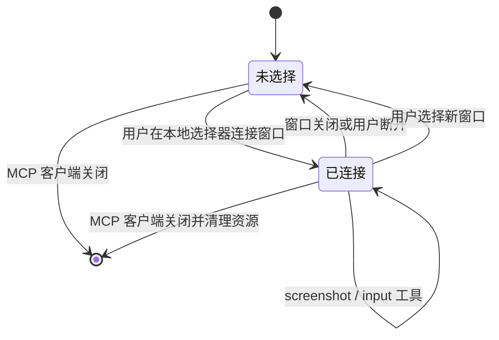

# Windows GUI MCP Agent 控制程序设计

## 1. 目标

提供一个运行在 Windows 桌面上的本地程序，让 AI Agent 通过 MCP 按照“截图 → 看图 → 操作 → 再截图”的循环，操纵用户明确选定的一个图形化窗口。

用户通过本地窗口选择器选定目标。Agent 只能调用当前绑定目标的截图与输入工具；它不能通过 MCP 参数切换窗口或传入任意窗口句柄。

## 2. 范围

第一版包含：

- Windows 桌面窗口列表、选择、连接、断开和重新选择。
- 目标窗口截图，并向 MCP 客户端返回 PNG 图片和尺寸信息。
- 鼠标移动、左右键点击、按住和释放、拖动、垂直/水平滚轮。
- Unicode 文本输入、命名按键、组合键、按键按住和释放。
- 窗口失效、捕捉失败、焦点失败、输入权限不匹配等明确错误。

第一版只支持一个已选定的顶层窗口，以及常规鼠标和键盘输入。不包含多窗口编排、远程控制、HTTP 服务器、游戏手柄、触屏或笔输入、UI 元素语义识别和 Agent 决策逻辑。

## 3. 方案与选择

| 方案 | 优点 | 代价 |
| --- | --- | --- |
| C#/.NET 单进程，内含本地选择器和 MCP stdio 服务 | 直接调用 Windows 桌面 API；不需要网络端口或额外 IPC；本地 Agent 启动即绑定 MCP 生命周期 | GUI 消息循环需要与 MCP 异步服务协调 |
| Python MCP 服务和本地窗口界面 | 原型代码精简 | Windows 捕捉、输入绑定及单文件分发需要更多第三方运行时和打包处理 |
| MCP 服务加独立桌面助手 | 两个组件职责独立 | 需要设计 IPC、安装和两个进程的生命周期管理 |

采用第一种。Windows `Windows.Graphics.Capture` 可捕捉显示器或应用窗口；Win32 的 `IGraphicsCaptureItemInterop::CreateForWindow` 可为指定 HWND 创建捕捉项。MCP 官方 C# SDK 提供 stdio MCP 服务支持。鼠标键盘输入使用 Win32 `SendInput`。[窗口捕捉 API](https://learn.microsoft.com/en-us/windows/win32/api/windows.graphics.capture.interop/nf-windows-graphics-capture-interop-igraphicscaptureiteminterop-createforwindow)、[MCP C# SDK](https://github.com/modelcontextprotocol/csharp-sdk)、[SendInput API](https://learn.microsoft.com/en-us/windows/win32/api/winuser/nf-winuser-sendinput)

## 4. 组件与职责

### 本地窗口选择器

- 枚举可见的顶层窗口，显示标题、进程名和 PID。
- 排除本程序自己的窗口、无标题的普通辅助窗口、已关闭或不可捕捉的窗口。
- 用户显式选择一行并点击“连接”；提供刷新、断开和重新选择操作。
- 显示当前绑定窗口和连接状态。MCP 工具不提供 `select_window`，也不接收 HWND 参数。

### MCP stdio 服务

- 在标准输入/输出上承载 MCP JSON-RPC 消息。
- `stdout` 只写 MCP 协议消息，诊断日志只写 `stderr`。
- 工具请求在单一目标的输入队列中串行执行，避免并发请求交错发送按键和鼠标事件。
- 客户端断开或标准输入关闭时，释放输入状态并清理捕捉会话。

### 目标窗口会话

保存 HWND、PID、进程启动标识、捕捉会话、客户区大小、标题和输入状态。每次操作前确认 HWND 仍有效，并核对 PID/进程身份以降低 HWND 被系统复用后误操作另一个窗口的风险。窗口关闭后销毁捕捉资源并清除绑定；不会自动切换到另一个窗口。

### 截图模块

- 使用 `Windows.Graphics.Capture` 和 `Direct3D11CaptureFramePool` 捕捉选定 HWND。
- 检查捕捉能力，处理新帧、帧尺寸变化和设备丢失。
- 将捕捉帧裁剪到客户区，编码为 PNG；MCP 响应同时包含图像和宽高、坐标说明。
- 捕捉失败时返回错误，不以旧图或空图冒充当前画面。

### 输入模块

- 使用 `SendInput` 发送鼠标和键盘事件。
- 程序启用 Per-Monitor V2 DPI 感知；将截图的客户区像素坐标映射到 Windows 物理屏幕坐标，并核对输入点位于绑定窗口范围内。
- 发输入前请求目标窗口到前台并立即再次核对前台窗口；核对失败时不发送事件。
- 跟踪本程序按下的键与鼠标键，在释放、出错、请求取消和关闭时尽力发送对应的释放事件。

## 5. 生命周期与数据流

1. MCP 客户端启动本地服务进程；进程显示窗口选择器并开始处理 stdio。
2. 用户在选择器中选定窗口并连接。没有绑定窗口时，截图和输入工具返回 `no_window_selected`。
3. Agent 调用 `screenshot`。服务取得当前捕捉帧，返回 PNG 与客户区宽高。
4. Agent 根据图像调用鼠标或键盘工具。输入坐标按 PNG 像素解释。
5. Agent 可再次调用 `screenshot` 检查应用变化，继续循环。
6. 用户断开/更换窗口，目标窗口关闭，或 MCP 客户端退出时，服务释放按住状态并销毁对应捕捉资源。

窗口选择器的本地用户操作是目标绑定的唯一入口。目标标题或进程名变化时，服务不会仅凭新标题重新绑定窗口。

## 6. MCP 工具契约

所有鼠标坐标均为截图客户区中的物理像素，原点位于左上角，`x` 向右、`y` 向下。有效范围是 `0 <= x < width` 且 `0 <= y < height`；超出范围返回 `out_of_bounds`。窗口大小或 DPI 改变后，服务重建捕捉帧池并返回新尺寸；Agent 应先获取新截图再使用新尺寸。`scroll` 的 `delta_x` 和 `delta_y` 是有符号滚轮刻度，每单位对应一个标准滚轮刻度。

| 工具 | 参数与行为 | 返回 |
| --- | --- | --- |
| `screenshot` | 无参数；捕捉当前绑定窗口 | MCP 图像内容 PNG，另含目标标题、宽度、高度和 `client-px` 坐标说明 |
| `move_mouse` | `x`, `y`, 可选 `duration_ms`（默认 0，范围 0–5000）；正值时直线插值移动 | 输入是否已发送及目标坐标 |
| `click` | `x`, `y`, `button: left\|right`, 可选 `click_count: 1\|2` | 输入是否已发送 |
| `mouse_down` | `x`, `y`, `button: left\|right`；按住并保留状态 | 当前按住状态 |
| `mouse_up` | `button: left\|right`；只释放由本服务记录为按下的对应按键 | 释放结果 |
| `drag` | 起点、终点、按钮、可选持续时间（默认 500 ms，范围 50–10000）；按直线路径插值 | 拖动是否完成；取消或错误时尝试释放按钮 |
| `scroll` | `x`, `y`, `delta_y`，可选 `delta_x` | 输入是否已发送 |
| `type_text` | `text`；发送字符串中的 Unicode 文本 | 已发送字符数或错误 |
| `key_press` | `key`，可选 `modifiers` 数组 | 输入是否已发送 |
| `key_down` | `key`；按住命名按键 | 当前按住状态 |
| `key_up` | `key`；只释放由本服务记录为按下的对应按键 | 释放结果 |

`mouse_down`/`mouse_up` 与 `key_down`/`key_up` 可跨调用组合成长按或键盘组合。重复按下同一键/按钮或释放一个未由本服务按下的键/按钮会返回状态错误，不发送额外事件。`key_press` 接受字母、数字、功能键及常见导航/控制键名；组合键修饰键限 Ctrl、Alt、Shift，不提供 Windows 键。服务会拒绝 Alt+Tab、Alt+Esc、Ctrl+Esc 和 Ctrl+Shift+Esc 等切换应用或调用系统界面的组合，也会识别由多次 `key_down`/`key_press` 拼成的这些组合。工具不能报告应用内部动作是否成功；Agent 必须通过后续截图自行确认。

## 7. 按住、取消和并发规则

- 单次 `click` 和 `drag` 尽可能在一个 MCP 请求中成对发送按下/释放事件。
- 显式 `*_down` 状态跨 MCP 请求保留，以支持不定时长按住和组合操作。
- 按住状态设置 60 秒看门狗；到期后自动尝试释放。每个对应的 `*_up` 会清除其看门狗。
- 任一输入请求异常、取消、目标失效、窗口切换或 stdio 连接结束时，服务尽力释放全部已记录的状态。
- 多个输入请求按到达顺序串行处理。截图可读取最新可用帧，但不可修改目标绑定。
- 若 `SendInput` 报告部分事件已发送，不自动重试整个点击或文本，以免产生双击或重复输入。

## 8. 错误处理

工具返回稳定的错误码和简明消息，至少包含：

- `no_window_selected`：本地选择器尚无绑定目标。
- `window_closed`：目标 HWND 已关闭或身份不匹配；清理绑定并要求重新选择。
- `window_minimized`：当前无法取得有效捕捉内容；提示恢复窗口。
- `capture_unavailable`：设备、捕捉会话或帧读取失败。
- `focus_failed`：不能把绑定窗口置于前台；不发送输入。
- `input_incomplete`：Win32 返回的已发送输入数不完整；清理按住状态，不自动重试动作。
- `out_of_bounds`：坐标超出当前客户区尺寸。
- `invalid_key` / `invalid_button`：键或鼠标按钮名称不受支持。
- `request_cancelled`：请求取消；拖动按取消清理路径尝试释放。

`SendInput` 可能因 UIPI 而无法向更高完整性级别进程注入输入；Windows 不保证返回值能够指出 UIPI 是失败原因。程序不自动提权；它报告输入失败，并指导用户让本程序与目标以兼容的权限级别运行。[Microsoft SendInput 文档](https://learn.microsoft.com/en-us/windows/win32/api/winuser/nf-winuser-sendinput)

## 9. 安全与隐私边界

- 每个 MCP 进程只维护一个由本地用户选定的窗口。
- MCP 客户端不能传入或更改 HWND；选择器是本地人工绑定点。
- 所有输入事件通过 Windows 全局输入流发送。服务每次输入前激活并检查目标窗口，但 Windows 不提供 `SendInput` 的 HWND 级硬隔离，因此无法消除检查与系统焦点变化之间的竞态。
- 工具输入日志只记录操作类别、目标 PID、坐标（如适用）和错误码，不记录文本内容或截图。
- 截图仅作为 MCP 图像响应返回，不默认持久化到磁盘。
- Agent 对选中应用的破坏性操作由用户选择目标窗口并启用 Agent 工具这一事实明确授权；程序不替 Agent 判断应用内容。

## 10. 平台与兼容性

- 目标平台：Windows 桌面。
- 窗口定向捕捉使用 `IGraphicsCaptureItemInterop::CreateForWindow`，最低支持 Windows 10 版本 1903（Build 18362）；更早系统不在第一版范围内。[API 最低版本](https://learn.microsoft.com/en-us/windows/win32/api/windows.graphics.capture.interop/nf-windows-graphics-capture-interop-igraphicscaptureiteminterop-createforwindow)
- 窗口必须允许系统捕捉。DRM 内容、安全桌面和受系统保护的表面可能无法捕捉；捕捉 API 不可用时返回错误。
- 单独弹出的原生对话框可能需要用户在选择器中重新选为目标窗口。第一版不跟踪同一进程创建的其他顶层窗口。
- 文本工具发送 Unicode 键盘输入，不承诺完整复现输入法的组合编辑过程；IME 特定流程可通过 `key_down`、`key_up` 和后续截图协作。

## 11. 验收标准

1. 在 MCP 客户端配置本地 stdio 服务后，启动服务会显示可操作的窗口选择器。
2. 选择窗口并连接后，`screenshot` 返回所选窗口内容而非选择器或其他窗口，并报告准确尺寸。
3. Agent 可完成左键/右键单击、双击、按下/释放长按、拖动、滚轮、Unicode 文本、命名按键与组合键。
4. 坐标越界时不发送输入；窗口尺寸改变后能返回新尺寸并允许 Agent 使用新截图坐标继续操作。
5. 目标关闭、最小化、焦点切换失败、捕捉失败、输入不完整时返回可识别错误；若输入失败可能由权限级别阻止，返回输入失败并提示该可能性（不声称 Windows 能区分 UIPI 原因）。已按住状态会被清理，不会自动切换目标或重放危险操作。
6. 输入操作按序执行；取消或关闭 MCP 连接能触发清理。
7. 日志不含截图像素或 `type_text` 的内容，MCP `stdout` 不含非协议输出。

交付时以构建与人工端到端验收为准：用一个普通权限级别的记事本类窗口验证截图、文本、按键和鼠标；用可调整大小和可关闭的窗口验证重新捕捉及目标失效处理；再验证权限级别不匹配时能够报告错误。此设计不要求新增自动化测试项目。

## 12. 官方接口参考

- [Windows Graphics Capture 概览](https://learn.microsoft.com/en-us/windows/apps/develop/media-authoring-processing/screen-capture)
- [为指定 HWND 创建 GraphicsCaptureItem](https://learn.microsoft.com/en-us/windows/win32/api/windows.graphics.capture.interop/nf-windows-graphics-capture-interop-igraphicscaptureiteminterop-createforwindow)
- [Win32 SendInput](https://learn.microsoft.com/en-us/windows/win32/api/winuser/nf-winuser-sendinput)
- [MCP 官方 C# SDK](https://github.com/modelcontextprotocol/csharp-sdk)
- [MCP stdio 传输规范](https://github.com/modelcontextprotocol/modelcontextprotocol/blob/main/docs/specification/2026-07-28/basic/transports/stdio.mdx)
